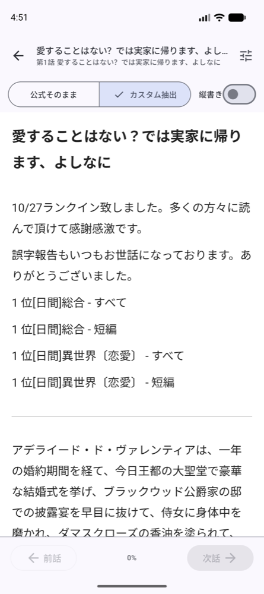
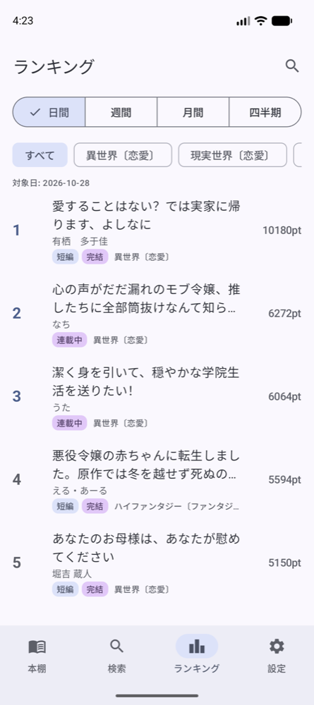

# NarouReader

[小説家になろう](https://syosetu.com/) の小説を読むための iOS / Android リーダーアプリです。

- 本棚管理・読書位置 (しおり) の自動保存と復元・話ごとの既読管理
- アプリ内リーダーでの本文表示 (フォントサイズ・行間・ダークモードなどの調整)
- 作品詳細・目次・検索・ランキング・他アプリからの共有受信
- 連載中の作品の更新チェック
- バックアップ (JSON ファイルへの書き出しと読み込み)
- Google アカウントでログインすると、iOS / Android 端末間で本棚・しおり・既読を同期

このリポジトリは配布と案内のためのもので、ソースコードは含みません。

## スクリーンショット

| 読書画面 (本文抽出) | ランキング |
| --- | --- |
|  |  |

画像はいずれも Android 版のものです。

## ダウンロード

最新版は [Releases](https://github.com/nunu1733/naroureader/releases) から取得できます
(「Latest」の付いた Release が最新の安定版です)。最新の安定 Release には Android APK と
iOS IPA を両方とも添付します。片方の OS だけが更新された Release では、未更新側は
その配布セット向けに承認済みの検証済みファイルをそのまま同梱します
(どの配布タグの成果物かは各 Release のノートに明記します)。

### Android (Android 8.0 以上)

1. Releases の Assets から `NarouReader-Android.apk` をダウンロードします。
2. ダウンロードした APK を開くとインストールが始まります。「この提供元からのインストールを
   許可しますか」の確認が表示された場合は、表示内容を確認して許可すると続行します。この許可は
   アプリの提供元ごとの設定であり、保護機能全体を無効化する必要はありません。
3. Google Play プロテクトが「未スキャンのアプリ」として確認を求める場合があります。
   スキャンを求められたら実行し、結果を確認してください。「このアプリは安全です」と
   表示された場合はインストールを続行できます。警告やブロックが残る場合は保護機能を
   無効化・回避せず、取得元と APK を確認し、解決しなければこのリポジトリの Issues へ
   報告してください。表示・判定は端末や時点により異なる場合があります
   (スキャンを求めずに進む場合もあります)。
4. 更新は自動では行われません。新しい版の APK をダウンロードして開くと、本棚・しおり・既読・
   設定を保持したまま上書き更新されます。アンインストールは不要です。
5. 更新管理アプリ [Obtainium](https://obtainium.imranr.dev/) に
   `https://github.com/nunu1733/naroureader` を登録すると、新しい安定版の公開時に更新を
   案内させることができます (任意。APK を自動で追跡します)。片方の OS だけが更新された
   Release でも Android の更新案内が出る場合があります。APK のアプリバージョンが
   前回と同じ場合は、インストールし直す必要はありません。

### iOS (iOS 17.0 以上・iPhone)

iOS へのインストールには SideStore または AltStore を使います。

1. [SideStore](https://sidestore.io/) / [AltStore](https://altstore.io/) をセットアップします
   (セットアップ方法は各公式サイトを参照してください)。
2. Source `https://altstore.xnunux.com/source.json` を追加すると、NarouReader のインストールと
   更新ができます。
3. Releases から `NarouReader.ipa` を直接ダウンロードすることもできますが、IPA ファイルを
   ダウンロードするだけでは iPhone にインストールできません。署名してインストールする環境
   (SideStore / AltStore など) が別途必要です。通常は Source 経由の利用を推奨します。

## 同期について

- アプリ内で Google アカウントでログインすると、同一アカウントでログインした端末間で
  本棚・しおり・既読が同期されます。iOS / Android をまたいで同期できます。
- 同期には Google アカウント認証と Firebase のクラウドサービスを使用します。
- 同期の対象は本棚登録・しおり・既読です。タグ・NG 登録・保存フィルタ・リーダー設定などは
  端末ごとのローカルデータで、同期されません。
- Google アカウントでログインしなくても、本棚・読書・検索は利用できます。

## 不具合報告

GitHub アカウントをお持ちの場合は、このリポジトリの
[Issues](https://github.com/nunu1733/naroureader/issues) に報告してください。
